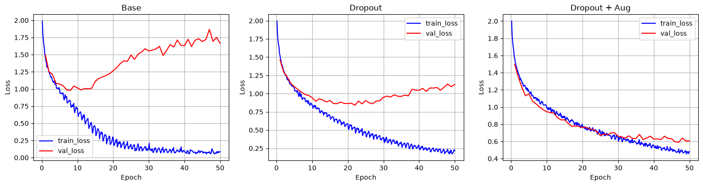

# ViT From Scratch

Implementation of a Vision Transformer from scratch.

- `data.py`: preprocessing of the CIFAR-10 dataset.
- `utils.py`: utilities functions (patching).
- `models.py`: ViT models implemented with PyTorch.
- `training.py`: training loop and evaluation loop functions.
- `train_cifar10.py`: script for the full training of a ViT classifier on the CIFAR-10 dataset.

## Experiments

Exploration of the impact of dropout and data augmentation over the performance of ViTs on CIFAR-10.

Model configuration (1.07M parameters):

- Patch size: 4
- Embedding size: 128
- Transformer layers: 8
- Attention heads: 4
- MLP size: 256

Training setup:

- Train size: 45k
- Val size: 5k
- Test size: 10k
- Epochs: 50
- Batch size: 64
- Optimizer: AdamW
- Learning rate: 5e-4

### Results

`compare.ipynb` compares the performances of 3 trained models:

- `Base`: no dropout and no data augmentation
- `Dropout`: base with dropout
- `Dropout + Aug`: base with dropout & data augmentation

The dropout probability is set to 0.1, and the data augmentation includes random horizontal flips with probability 0.5, and random shifts up to 4px vertically and horizontally.

Results show that Base and Dropout models tend to overfit quickly, while the model trained on augmented data plateaus much later, achieving about 80% accuracy on the validation set.

The final test losses and accuracies are reported in the following table:

|               |   Test loss |   Test accuracy |
|:--------------|------------:|----------------:|
| Base          |       1.674 |           68.0% |
| Dropout       |       1.164 |           71.6% |
| Dropout + Aug |       0.621 |           79.7% |

## References

- Ashish Vaswani, Noam Shazeer, Niki Parmar, Jakob Uszkoreit, Llion Jones, Aidan N. Gomez, Łukasz Kaiser, and Illia Polosukhin. "Attention Is All You Need." *Advances in Neural Information Processing Systems (NeurIPS)*, 2017. [arXiv:1706.03762](https://arxiv.org/abs/1706.03762)
- Alexey Dosovitskiy, Lucas Beyer, Alexander Kolesnikov, Dirk Weissenborn, Xiaohua Zhai, Thomas Unterthiner, Mostafa Dehghani, Matthias Minderer, Georg Heigold, Sylvain Gelly, Jakob Uszkoreit, and Neil Houlsby. "An Image is Worth 16x16 Words: Transformers for Image Recognition at Scale." *International Conference on Learning Representations (ICLR)*, 2021. [arXiv:2010.11929](https://arxiv.org/abs/2010.11929)
